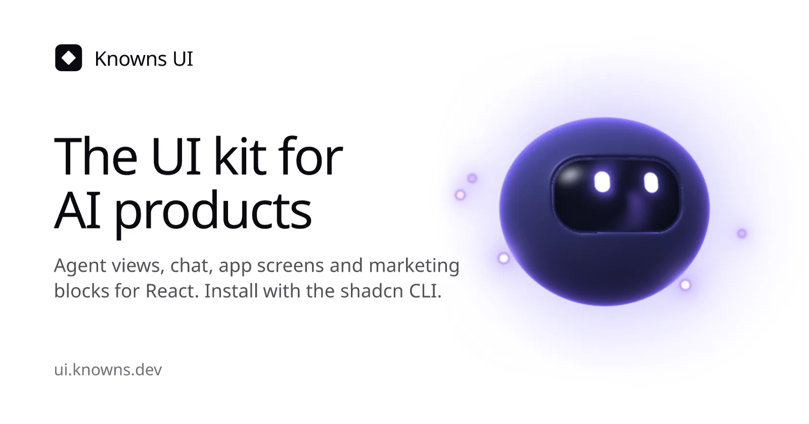
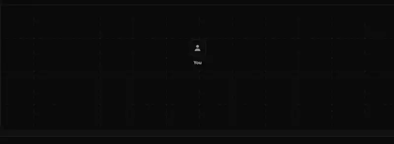

<div align="center">

<picture>
  <source media="(prefers-color-scheme: dark)" srcset=".github/assets/logo-white.png">
  
</picture>

# Knowns UI

The UI kit for AI products.<br>
Agent views and chat, app screens, marketing sections and backgrounds. React and Tailwind, copied into your repo with the shadcn CLI.

[Docs](https://ui.knowns.dev/docs/introduction) · [Components](https://ui.knowns.dev/components) · [Blocks](https://ui.knowns.dev/blocks) · [Pricing](https://ui.knowns.dev/pricing)

</div>

<picture>
  <source media="(prefers-color-scheme: dark)" srcset=".github/assets/hero-dark.webp">
  <source media="(prefers-color-scheme: light)" srcset=".github/assets/hero-light.webp">
  
</picture>

## Why Knowns UI

- **One run store, every view.** Feed agent events into one run; the graph, lanes, traces, approvals and chat all read it and stay in sync.
- **You own the source.** It is a [shadcn registry](https://ui.shadcn.com/docs/registry), not a package: the CLI copies each component into your project. Tailwind CSS v4 and the shadcn/ui theme tokens.
- **AI-ready.** An MCP server and plain-text docs let Claude Code, Cursor and VS Code find, read and install components for you.



## Quick example

```tsx
import { createAgentRun } from "@/lib/knowns/run";
import { AgentGraph } from "@/components/ui/knowns/agent-graph/agent-graph";

const run = createAgentRun();
run.emit({ type: "actor", actor: { id: "lead", type: "agent", label: "Orchestrator", root: true } });
run.emit({ type: "actor", actor: { id: "web", type: "tool", label: "Web search" } });
run.emit({ type: "span.start", id: "s1", from: "lead", to: "web", summary: "pricing linear.app" });

export default function Run() {
  return <AgentGraph run={run} />;
}
```

Events can come from your own code, a replay, or an adapter for your agent SDK. Every view takes `run={run}`.

## Install

Requires React 19, Tailwind CSS v4 and a shadcn `components.json` (run `npx shadcn@latest init` if you have none).

```bash
npx shadcn@latest add https://ui.knowns.dev/r/agent-graph.json
```

Once Knowns UI is listed in the shadcn registry index you can also use the namespace:

```bash
npx shadcn@latest add @knowns-ui/agent-graph
```

Registry dependencies (the core types, the run store, icons) come along automatically.

## What's in Free

- **Agent views:** graph, lanes, trace waterfall, context window, tool calls, approvals, plans, monitors, fleets, handoffs and cursors.
- **Chat:** composer, message actions, thinking state, token stream and AI answers.
- **Base components:** actions, forms, overlays, navigation, data display and feedback.
- **Page blocks:** hero and marketing sections, site header and footer, sidebar, app shell, auth, settings, blog, docs and error pages.
- **Motion:** backgrounds, text animation and illustrations.

Browse them all, with live examples and the install command for each: [Components](https://ui.knowns.dev/components) · [Blocks](https://ui.knowns.dev/blocks).

## Pro

[Knowns UI Pro](https://ui.knowns.dev/pricing) adds, on the same run store:

- **Blocks:** an Agent Ops dashboard, a Chat App screen, a Kanban board, the Agent Globe, page headers, task detail and pricing sections.
- **SDK adapters:** turn the Claude Agent SDK, the Vercel AI SDK or the OpenAI Agents SDK stream into run events, server to browser.
- **More motion:** animated illustrations, backgrounds and text animations.
- **Semantic docs search** in the MCP server, and Pro updates for life.

## Using with AI

Connect your coding agent to the Knowns UI MCP server (`https://ui.knowns.dev/mcp`), point it at one component's JSON (`https://ui.knowns.dev/r/<name>.json`), or give it the docs as text (`https://ui.knowns.dev/llms.txt`). Setup for Claude Code, Cursor, VS Code and Codex: https://ui.knowns.dev/docs/ai-and-mcp

## Contributing

Issues and pull requests are welcome. See [CONTRIBUTING.md](CONTRIBUTING.md) for how changes flow back into a release.

## Develop

```bash
bun run build   # shadcn build: registry.json to public/r
bun run check   # installs every item into a fresh Next.js app and type-checks it
```

## License

MIT for the code. See [LICENSE](LICENSE).

## Trademarks

The model and tool logos in `registry/knowns/lib/knowns/icons` are trademarks of their owners. They are not covered by the MIT license, are here only to identify those products, and may not be used commercially or to suggest endorsement. Sources and terms: [LICENSES.md](registry/knowns/lib/knowns/icons/LICENSES.md).
