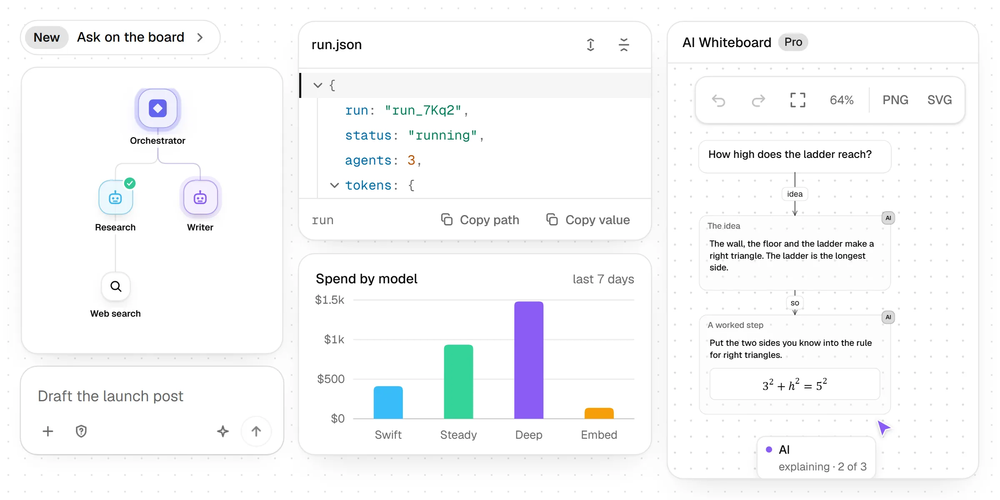
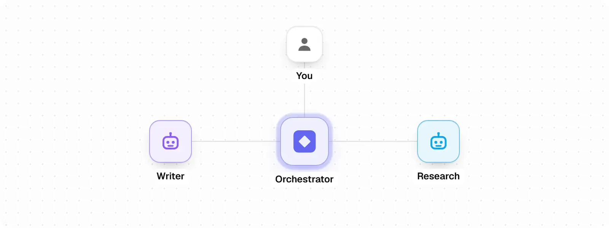

<div align="center">

<picture>
  <source media="(prefers-color-scheme: dark)" srcset=".github/assets/logo-white.png">
  
</picture>

# Knowns UI

The UI kit for AI products.<br>
Every screen your AI product needs: agent views and chat, app screens, marketing sections and backgrounds. React and Tailwind, copied into your repo with the shadcn CLI.

[Docs](https://ui.knowns.dev/docs/introduction) · [Components](https://ui.knowns.dev/components) · [Blocks](https://ui.knowns.dev/blocks) · [Pricing](https://ui.knowns.dev/pricing)

</div>

<picture>
  <source media="(prefers-color-scheme: dark)" srcset=".github/assets/hero-dark.webp">
  <source media="(prefers-color-scheme: light)" srcset=".github/assets/hero-light.webp">
  
</picture>

## Why Knowns UI

- **One run store, every view.** Feed agent events into one run; the graph, lanes, traces, approvals and chat all read it and stay in sync.
- **You own the source.** It is a [shadcn registry](https://ui.shadcn.com/docs/registry), not a package: the CLI copies each component into your project. Tailwind CSS v4 and the shadcn/ui theme tokens.
- **AI-ready.** `npx knowns-ui@latest skill` installs an agent skill with the kit's visual rules, and the MCP server and plain-text docs let Claude Code, Cursor and VS Code find, read and install components for you.

<picture>
  <source media="(prefers-color-scheme: dark)" srcset=".github/assets/demo-dark.webp">
  <source media="(prefers-color-scheme: light)" srcset=".github/assets/demo-light.webp">
  
</picture>

## Quick example

```tsx
import { createAgentRun } from "@/lib/knowns/run";
import { AgentGraph } from "@/components/ui/knowns/agent-graph/agent-graph";

const run = createAgentRun();
run.emit({ type: "actor", actor: { id: "lead", type: "agent", label: "Orchestrator", root: true } });
run.emit({ type: "actor", actor: { id: "web", type: "tool", label: "Web search" } });
run.emit({ type: "span.start", id: "s1", from: "lead", to: "web", summary: "find launch checklists" });

export default function Run() {
  return <AgentGraph run={run} />;
}
```

Events can come from your own code, a replay, or an adapter for your agent SDK. Every view takes `run={run}`.

## Install

Requires React 19, Tailwind CSS v4 and a shadcn `components.json` (run `npx shadcn@latest init` if you have none).

```bash
npx knowns-ui@latest add agent-graph
```

Knowns UI is in the shadcn registry index, so the shadcn CLI takes the namespace too:

```bash
npx shadcn@latest add @knowns-ui/agent-graph
```

Or point it at the item's JSON directly:

```bash
npx shadcn@latest add https://ui.knowns.dev/r/agent-graph.json
```

Registry dependencies (the core types, the run store, icons) come along automatically.

## What's in Free

157 components and blocks (187 registry items with their dependencies), MIT licensed. Newest first:

- **Agent views (14):** JSON Inspector, Agent Graph, Approval Prompt, Call Overlay, Live Activity, Agent Lanes, Tool Call Card, Context Window, Trace Waterfall, Agent Monitor, Agent Fleet, Agent Handoff, and 2 more.
- **Chat (6):** Chat Composer, Thinking State, Conversation List, AI Answer, Message Actions, Ghost Text.
- **Components (68):** Animated Number, Calendar, Date Picker, Date Range Picker, Carousel, Context Menu, Data Table, Drawer, Empty, Filter Chips, Floating Dock, Heatmap, and 56 more.
- **Blocks (43):** Announcement Pill, Answer Pad, Area Trend Card, Class Roster, Eval Score, Feature Trio, Footer Wordmark, Footer Columns, Footer Minimal, Footer Status, Goal Rings, Now Playing, and 31 more.
- **Motion and illustrations (26):** Context Memory, Rain Field, Dot Spotlight, Signal Lines, Aurora, Node Field, Perspective Grid, Grid Pattern, Dither Field, Flickering Grid, Cube Field, Gradient Floor, and 14 more.

Browse them all, with live examples and the install command for each: [Components](https://ui.knowns.dev/components) · [Blocks](https://ui.knowns.dev/blocks).

## Pro

[Knowns UI Pro](https://ui.knowns.dev/pricing) adds, on the same run store:

- **AI whiteboard:** a board a person and an AI work on together. Ask a question on the board and the AI cursor builds linked guide panels beside it (Explain, Answer, Hint, Steps).
- **AI CMS:** a content table, a post editor with AI help, an SEO panel, a media library with search by description, and an editorial desk template.
- **Agent screens:** an agent inbox for human-in-the-loop work, an Agent Ops dashboard, run overviews and traces, workflow and node graph editors.
- **Blocks:** chart morph, testimonials with faces, a Chat App screen, a Kanban board, the Agent Globe, page headers, task detail and pricing sections.
- **SDK adapters:** turn the Claude Agent SDK, the Vercel AI SDK or the OpenAI Agents SDK stream into run events, server to browser.
- **More motion:** animated illustrations, backgrounds and text animations.
- **Semantic docs search** in the MCP server, and Pro updates for life.

## Using with AI

Install the agent skill with `npx knowns-ui@latest skill`: it teaches your coding agent the kit's visual rules (type, spacing, colour, motion) so new screens match. Connect it to the Knowns UI MCP server (`https://ui.knowns.dev/mcp`), point it at one component's JSON (`https://ui.knowns.dev/r/<name>.json`), or give it the docs as text (`https://ui.knowns.dev/llms.txt`). Setup for Claude Code, Cursor, VS Code and Codex: https://ui.knowns.dev/docs/ai-and-mcp

## Contributing

Issues and pull requests are welcome. See [CONTRIBUTING.md](CONTRIBUTING.md) for how changes flow back into a release.

## Develop

```bash
bun run build   # shadcn build: registry.json to public/r
bun run check   # installs every item into a fresh Next.js app and type-checks it
```

## License

MIT for the code. See [LICENSE](LICENSE).

## Trademarks

The model and tool logos in `registry/knowns/lib/knowns/icons` are trademarks of their owners. They are not covered by the MIT license, are here only to identify those products, and may not be used commercially or to suggest endorsement.

The sign-in provider marks (the `social-button` item, `social-icons.data.ts`) are also trademarks of their owners. They may be used, in commercial apps too, only to identify the provider, for example on a sign-in button, and only by following that provider's brand guidelines. They do not suggest endorsement. Sources and terms for all of them: [LICENSES.md](registry/knowns/lib/knowns/icons/LICENSES.md).
